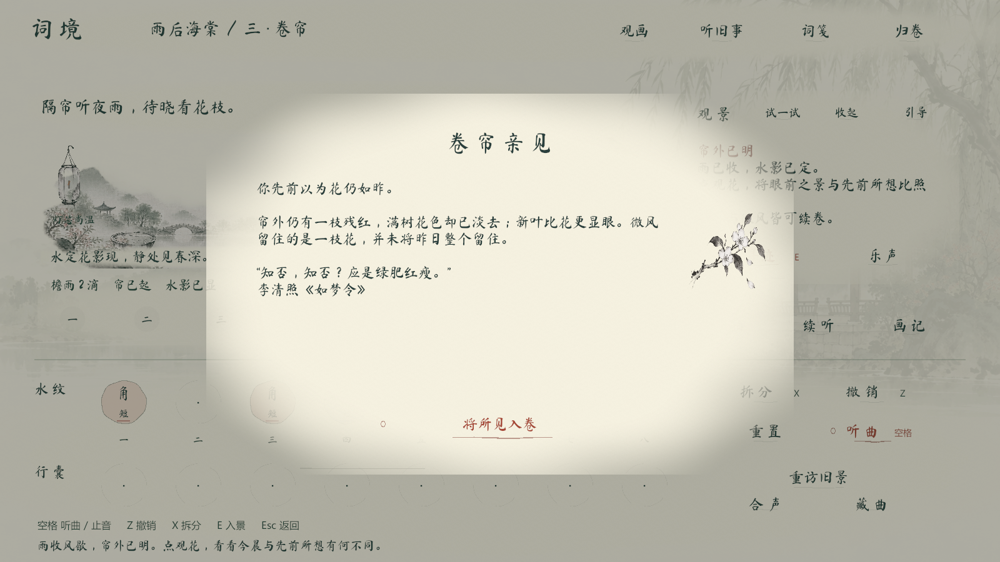
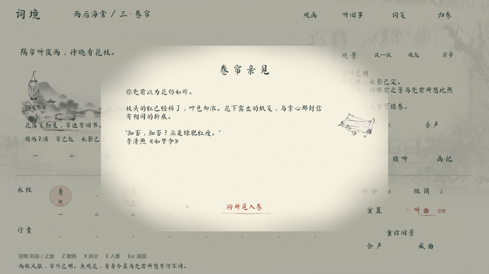

# 词境 · 二合古风休闲解谜

把有限的音石排成八拍乐句，在风雨、水影和帘幕的变化中读词、寻物、解谜。Unity 2022.3.62f3c1 / URP 2D / uGUI，当前 Demo 为 v0.15，三章九景。

试玩、源码压缩包和讲解视频统一入口：[https://github.com/yukidrift2358-oss/CiJing/releases/tag/v0.15](https://github.com/yukidrift2358-oss/CiJing/releases/tag/v0.15)

策划讲解（约 5 分半）：
https://github.com/yukidrift2358-oss/CiJing/releases/download/v0.15/CiJing-Design-v3.mp4

主线全流程与附加内容（约 9 分半）：
https://github.com/yukidrift2358-oss/CiJing/releases/download/v0.15/CiJing-Walkthrough-v3.mp4

讲解稿、字幕、章节和制作方法见 [展示材料](Docs/Showcase)。附加回访与引导画面使用有标记的运行截图，详细方法见制作记录。

## 合成为什么需要取舍

两颗同音同阶短音合成长音，材料总量不变，但两次起音变成一次长声。八个位置中留下的空拍会影响风雨消退。玩家可以拆分、撤销和重听，试听不扣材料；主线每景提供固定材料，自由谱曲的取音另行开放。

第二章以景物结果通关：雨滴分开、帘起、风歇、水定。卷帘把两份羽合成长风会吹落花瓣、露出旧笺；保留两次短风可留一枝残红。演奏完成还须点“观花”，比照猜想并确认入卷；确认前改谱会使待确认结果失效。

## 内容与实现范围

- 三章九景、三则藏曲、两处独立旧景回访。
- 卷轴寻物、八主题操作小卷、拆分撤销、存档、自由谱曲与此行留卷。
- 二维分层、墨染显现与随解谜逐步添色；演出使用 Unity 原生效果，没有使用 Live2D Cubism 人物模型。
- 章节配乐、风雨纹理、帘后音色与西楼隔水回应，完成时接入收束乐句。

详细操作：[v0.15 试玩说明](Docs/v015-试玩说明.md)。规则与限制：[景物目标与旧景回访](Docs/v015-景物目标与旧景回访.md)。

## 验证与仍待回答的问题

已保留的 v0.15 构建记录为成功，0 错误、0 警告；规则检查共 169 项断言，检查九景流程与存档，卷帘枚举得到 30 种落笺排列、75 种留花排列。这是有效排列数，不代表独立关卡数，也不是真人体验测试数据。记录见 [验证摘要](Docs/Showcase/v015-validation.json)。

提示是否过多、两种结果能否被理解、重复听音是否疲劳，尚需实际试玩。项目没有完整商业化成长系统，也没有音乐节奏评分。李清照词句与自撰叙事分别标明，故事按词意改编，不是生平或宋代音乐复原。

## 版本与工程打开方式

[15 份工程快照与版本比较](Docs/Showcase/迭代记录.md)。提交是当前导入，未倒签开发时间。各版本保留 Unity .meta 文件。

用 Unity 2022.3.62f3c1 打开仓库目录，入口场景为 `Assets/Scenes/CiJing.unity`。正常运行所需素材已包含。批处理构建入口为 `CiJing.EditorTools.BuildGame.Run`，会重新创建入口场景并输出至工程同级 Deliverables；运行构建前请保存自己的场景修改。原生录制所需 FFmpeg 和音频开发脚本依赖没有打包进仓库。

## 素材与制作说明

美术包含 AI 生成水墨素材；配乐使用 VSCO CC0 竖琴、长笛录音重新编排，风雨纹理由项目制作。来源与许可见 [音频致谢](Docs/Audio-Credits-v05.md)、[VSCO 许可](Docs/VSCO-LICENSE.txt) 及工程内字体 OFL 文件。原词、改编叙事与第三方素材应按各自来源区分。

此仓库用于展示和查看工程，没有为整个项目额外授予统一开源许可；第三方素材仍遵守各自许可。

